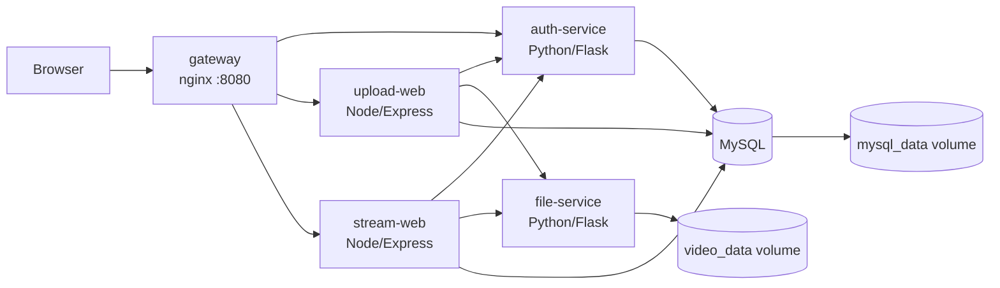

# Video Streaming System (CIT3495 Project 1)

A containerized microservices system where authenticated users upload videos and stream them in the browser. It is built with Python and Node.js, orchestrated with Docker Compose, and shipped through a GitHub Actions pipeline that tests, builds, scans, tags and publishes multi-architecture images.

[](https://github.com/AidenDeveloper/video-system/actions/workflows/ci.yml)

## Architecture



| Service | Language | Role | Reachable from host? |
|---|---|---|---|
| `gateway` | nginx | Single entry point, routing, login rate limiting, friendly 503 pages | **Yes**, `127.0.0.1:8080` only |
| `auth-service` | Python (Flask, gunicorn) | Login, JWT issue and verify, user store | No |
| `upload-web` | Node.js (Express) | Upload form; metadata to MySQL, file to file-service | No |
| `stream-web` | Node.js (Express) | Video list from MySQL; Range-aware streaming from file-service | No |
| `file-service` | Python (Flask, gunicorn) | Reads and writes video files on a persistent volume | No (private network only) |
| `mysql` | MySQL 8.4 | Users and video metadata | No (private network only) |

### Data flow

1. The user logs in at `/login`. `auth-service` checks the password hash in MySQL and sets an `HttpOnly`, `SameSite=Strict` JWT cookie.
2. **Upload:** `upload-web` asks `auth-service` to verify the cookie and checks the `uploader` role. It validates the file (size limit and magic bytes, MP4 or WebM only), streams it to `file-service` with an internal API key, then inserts the metadata row into MySQL.
3. **Stream:** `stream-web` verifies the cookie, reads the video list from MySQL, and proxies the file from `file-service`, forwarding HTTP `Range` headers so seeking works.

### Networks

- `public`: `gateway`, `auth-service`, `upload-web`, `stream-web`.
- `private` (`internal: true`, no outside access): `mysql`, `file-service`, plus the services that need them.
- Only the gateway publishes a port, and it is bound to `127.0.0.1`.

## Prerequisites

- Docker Desktop (or Docker Engine) with Compose v2 and buildx
- Git
- Optional, for running tests locally: Node.js 20 and Python 3.12

## Quick start (from a clean checkout)

### Windows (PowerShell)

```powershell
git clone https://github.com/AidenDeveloper/video-system.git
cd video-system
powershell -ExecutionPolicy Bypass -File .\scripts\gen-secrets.ps1
Copy-Item .env.example .env
docker compose up -d --build --wait
docker compose ps
```

### Linux / macOS / Git Bash

```bash
git clone https://github.com/AidenDeveloper/video-system.git
cd video-system
./scripts/gen-secrets.sh
cp .env.example .env
docker compose up -d --build --wait
docker compose ps
```

All six services should report `healthy`. The first start takes about a minute while MySQL initializes.

Open **http://localhost:8080**.

### Run from published images instead of building

Edit `.env`, setting `REGISTRY=ghcr.io/aidendeveloper` (must be lowercase) and `TAG=latest`, then:

```bash
docker compose pull
docker compose up -d --no-build --wait
```

## Using the system

**Admin login:** username `admin`. The password is randomly generated into `secrets/admin_password`:

```powershell
Get-Content secrets/admin_password      # Windows
cat secrets/admin_password              # Linux/macOS
```

**Create more users** (prompts for the password):

```bash
docker compose exec -it auth-service python manage.py adduser alice viewer
docker compose exec -it auth-service python manage.py adduser bob uploader
```

| Role | Can watch videos | Can upload |
|---|---|---|
| `viewer` | Yes | No (HTTP 403) |
| `uploader` | Yes | Yes |

**Routes:** `/login`, `/logout`, `/upload` (uploaders), `/videos`, `/api/videos`, `/stream/<id>`.

## Configuration

Secrets are never stored in the repository or in environment variables. They are generated into `secrets/` (gitignored) and mounted into containers as Docker Compose file secrets under `/run/secrets/`. Services read them through `*_FILE` variables.

| `.env` variable | Default | Purpose |
|---|---|---|
| `REGISTRY` | `ghcr.io/<user>` | Image registry prefix (lowercase) |
| `TAG` | `dev` | Image tag |
| `WEB_CONCURRENCY` | `1` | gunicorn workers for the Python services |
| `AUTH_CACHE_TTL_MS` | `0` | Node services cache verified tokens for this long (0 = off) |
| `LIST_CACHE_TTL_MS` | `0` | `stream-web` caches the video list for this long (0 = off) |

## Security

- **Authentication:** JWT in an `HttpOnly`, `SameSite=Strict` cookie. Upload and stream routes require a valid token, and uploads require the `uploader` role.
- **Network isolation:** MySQL and `file-service` sit on an internal-only network. `file-service` additionally requires an internal API key (compared in constant time).
- **Secrets:** file-based Compose secrets, generated per environment, with no hardcoded values.
- **Least privilege:** non-root users in every container, `read_only` root filesystems, `cap_drop: [ALL]`, `no-new-privileges`. MySQL accounts have table-level `SELECT, INSERT` grants only, with separate accounts for auth and video data.
- **Input validation:** username regex, password length limits, upload size limit (200 MB), magic-byte file-type check, UUID-only file names, parameterized SQL, HTML-escaped output.
- **Login rate limiting** at the gateway.
- **Vulnerability scanning:** Trivy in CI (fails the build on fixable HIGH/CRITICAL findings). Local results are saved in `docs/trivy-*.txt`.

## Health checks and recovery

Every service has a Docker `HEALTHCHECK` (Compose waits on them through `depends_on: condition: service_healthy`). The web services and `auth-service` include a database check, so they report `unhealthy` when MySQL is down. Containers use `restart: unless-stopped`. The gateway re-resolves service names through Docker DNS, so restarted containers are found again without reloading nginx.

| Failure | Behavior | Recovery |
|---|---|---|
| MySQL stopped | Login and video list return 503; services show `unhealthy` | Automatic once MySQL is healthy again |
| `file-service` killed | Upload and stream return 502 | Auto-restarted by the restart policy |
| `auth-service` stopped | All protected routes return 503 (fails closed) | Automatic on restart |

## Persistence

Named volumes `mysql_data` (database) and `video_data` (video files) survive container recreation:

```bash
docker compose rm -sf mysql file-service
docker compose up -d --wait
```

> `docker compose down -v` **deletes the volumes** (all users, metadata and videos).

## Resource limits

| Service | CPU | Memory | Why |
|---|---|---|---|
| `mysql` | 1.0 | 768 MB | InnoDB buffer pool and connections need headroom |
| `auth-service` | 0.5 | 256 MB | scrypt hashing uses about 32 MB per concurrent login |
| `file-service` | 0.5 | 256 MB | Streams chunks, so low memory |
| `upload-web` | 0.5 | 512 MB | Its 256 MB `/tmp` tmpfs counts toward container memory |
| `stream-web` | 0.5 | 256 MB | Proxies streams without buffering |
| `gateway` | 0.25 | 128 MB | Reverse proxy only |

Check actual usage with `docker stats --no-stream`.

## Docker image practices

- Multi-stage builds for every Python and Node image (dependencies built in a builder stage, slim or alpine runtime stage).
- `.dockerignore` in every build context, with dependency layers ordered before source for better caching.
- BuildKit cache mounts for pip and npm.
- Multi-architecture images (`linux/amd64`, `linux/arm64`) published by CI.
- Before/after Dockerfiles for the size and build-time comparison are in `docs/before/`.

## Logs and observability

```bash
docker compose logs -f --tail=50                 # everything
docker compose logs auth-service | grep "login failed"
docker stats --no-stream
```

Node services emit JSON log lines, Python services emit timestamped text, and the gateway emits an access log with request and upstream timings. Passwords, tokens and secrets are never logged.

## Testing

```bash
# Node (from repo root)
npm --prefix upload-web test
npm --prefix stream-web test

# Python
pip install -r auth-service/requirements.txt -r file-service/requirements.txt pytest
python -m pytest auth-service -q
python -m pytest file-service -q
```

### Load test (k6)

```powershell
$pw = (Get-Content secrets/admin_password -Raw).Trim()
docker run --rm -i --network videosys_public -e LT_USER=admin -e LT_PASS=$pw `
  -v "${PWD}/loadtest:/s" grafana/k6 run /s/api.js
```

Run it while watching `docker stats` in another terminal. Change `AUTH_CACHE_TTL_MS`, `LIST_CACHE_TTL_MS` or `WEB_CONCURRENCY` in `.env`, run `docker compose up -d`, and re-run to compare.

## CI/CD

`.github/workflows/ci.yml` runs on every push and pull request:

1. **test:** pytest (Python) and `node --test` (Node).
2. **smoke:** brings the full stack up with Compose and checks login, the authenticated API, and that unauthenticated access is redirected.
3. **build-scan-push** (per service): build, Trivy scan, then on `main` and version tags a multi-arch (amd64 and arm64) build pushed to GHCR.

Image tags: `sha-<commit>`, `latest` (default branch), and semantic versions from `v*` git tags (for example `git tag v1.0.0 && git push --tags`).

## Project structure

```
video-system/
├── docker-compose.yml
├── .env.example
├── auth-service/        Python: login, JWT, users
├── file-service/        Python: file storage API
├── upload-web/          Node.js: upload app
├── stream-web/          Node.js: video list and streaming
├── gateway/             nginx reverse proxy
├── mysql/init/          schema and least-privilege DB users
├── scripts/             secret generation (.sh and .ps1)
├── loadtest/            k6 load test
├── docs/                evidence: scans, load tests, before/after Dockerfiles
└── .github/workflows/   CI pipeline
```

## Troubleshooting

| Symptom | Fix |
|---|---|
| `repository name must be lowercase` | Use a lowercase `REGISTRY` in `.env` |
| `npm ci` fails with "lock file out of sync" | Delete `package-lock.json` and run `npm install` in that folder |
| MySQL exits with `\r` or "bad interpreter" | `mysql/init/01-schema.sh` must use LF line endings; then `docker compose down -v` and start again |
| Gateway restarts in a loop | Run `docker compose logs gateway`, then `docker compose run --rm --no-deps --entrypoint nginx gateway -t` |
| Login fails after regenerating secrets | The admin account is created on first start only; reset with `docker compose down -v` |
| `curl` behaves oddly on Windows PowerShell | Use `curl.exe` |

## Known limitations

- No TLS in the Compose setup. In production, terminate HTTPS at the gateway and set `COOKIE_SECURE=true`.
- JWTs cannot be revoked before they expire (1 hour). The optional token cache widens this window by its TTL.
- If MySQL fails after a file has been stored, the stored file is orphaned (no cleanup job).
- Single MySQL instance with no replication or backups.
